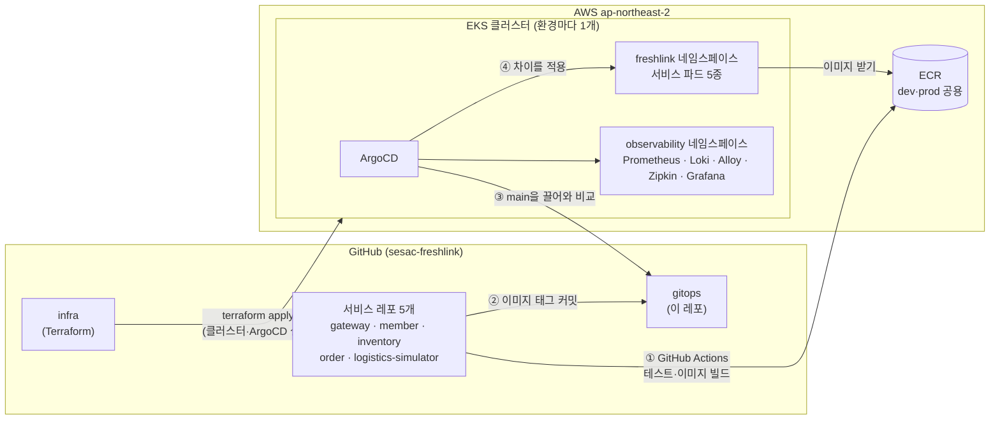
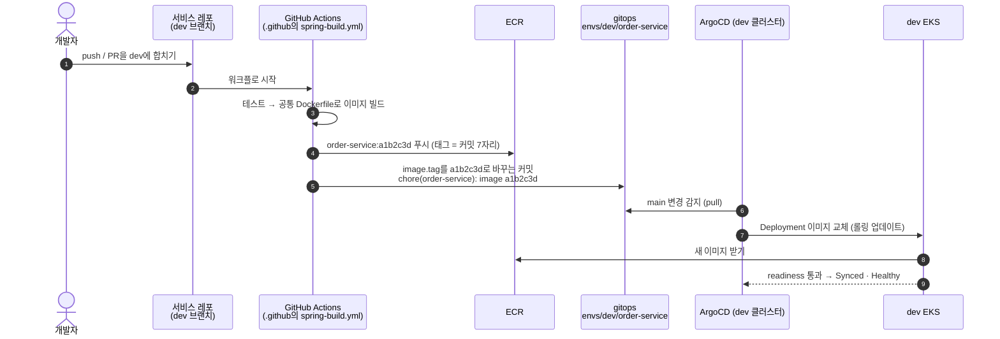
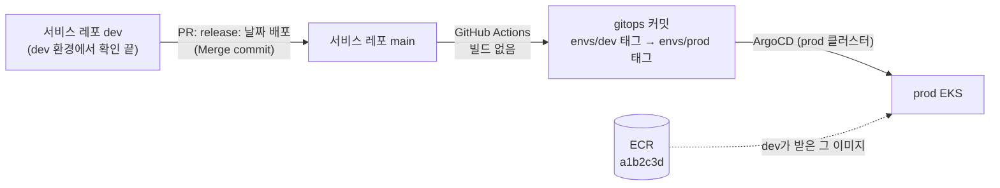
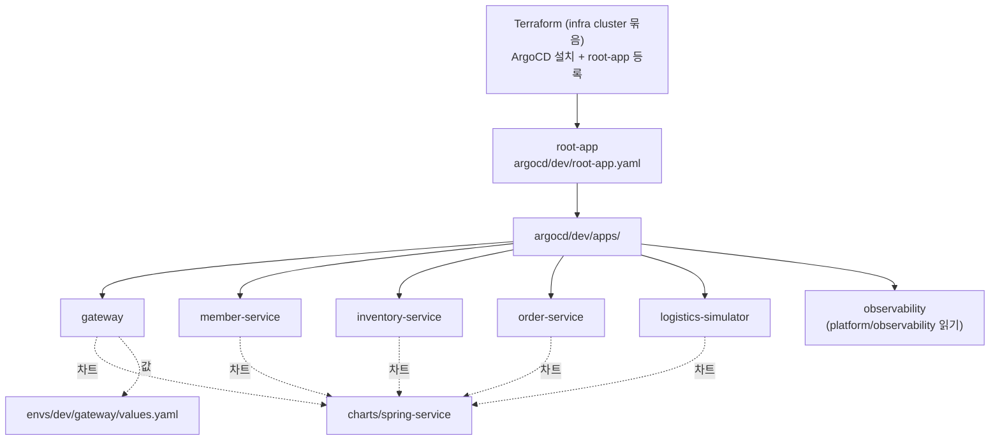

# gitops

> **"클러스터 안에 무엇이 떠 있어야 하는가"를 적어 둔 레포.** dev·prod 각 EKS 클러스터 안의 ArgoCD가 이 레포를 지켜보다가, 바뀐 내용을 클러스터에 그대로 맞춘다. 사람도 CI도 클러스터에 직접 배포하지 않는다.

| 항목 | 내용 |
| --- | --- |
| 담당 | 김진아 |
| 관련 기능 ID | I-02 CI/CD, I-03 관측성 |
| 기술 | Helm, ArgoCD (App of Apps), Kubernetes, Grafana Alloy·Loki·Prometheus·Zipkin |
| 환경 | dev, prod 2개. 같은 차트를 쓰고 `envs/<환경>/` 의 값만 다르다 |
| 브랜치 | `main`만. `main`이 곧 두 클러스터의 목표 상태 |
| 지금 상태 | 관측성 Application 초안만 있다. 공용 차트·환경별 values·ArgoCD Application은 dev 클러스터가 생긴 뒤 채운다 ([10장](#10-지금-상태와-남은-일)) |

**목차**

1. [이 레포가 맡는 것](#1-이-레포가-맡는-것)
2. [전체 그림](#2-전체-그림)
3. [두 환경: dev와 prod](#3-두-환경-dev와-prod)
4. [배포 흐름](#4-배포-흐름)
5. [폴더 구조](#5-폴더-구조)
6. [ArgoCD App of Apps](#6-argocd-app-of-apps)
7. [공용 차트 `spring-service` 규칙](#7-공용-차트-spring-service-규칙)
8. [서비스별 파드 계획](#8-서비스별-파드-계획)
9. [자주 하는 작업](#9-자주-하는-작업)
10. [지금 상태와 남은 일](#10-지금-상태와-남은-일)
11. [규칙 요약](#11-규칙-요약)
12. [관련 문서](#12-관련-문서)

---

## 1. 이 레포가 맡는 것

FreshLink의 인프라 코드는 레포 두 개로 나뉜다. 바뀌는 주기와 위험도가 달라서다. 이미지 태그 하나 바꿀 때마다 Terraform 레포를 건드리지 않게 한다.

| | [`infra`](https://github.com/sesac-freshlink/infra) | `gitops` (이 레포) |
| --- | --- | --- |
| 질문 | AWS에 **무엇이 있는가** | 클러스터 안에 **무엇이 떠 있는가** |
| 도구 | Terraform | Helm + ArgoCD |
| 다루는 것 | VPC, EKS·노드 그룹, RDS, SQS, ECR, Cognito, IAM(IRSA), S3·CloudFront, ArgoCD 설치 자체 | 서비스 5개의 Deployment·Service·Ingress, 파드 수, 이미지 태그, 환경 변수, 관측성 스택 |
| 적용 방법 | `terraform apply` (사람) | `main`에 커밋하면 ArgoCD가 끌어간다(pull) |
| 바뀌는 빈도 | 드물다 | 하루에도 여러 번 (CI의 이미지 태그 커밋) |

경계선은 **ArgoCD**다. Terraform이 클러스터를 만들고 ArgoCD·AWS Load Balancer Controller·metrics-server·External Secrets Operator까지 Helm으로 올린다. 그다음부터 클러스터 안에 올라가는 것은 전부 이 레포가 정한다.

**왜 GitOps인가**

- 지금 클러스터에 무엇이 떠 있는지 이 레포만 보면 안다. "누가 언제 무엇을 바꿨나"는 커밋 이력이 답한다.
- 롤백은 커밋 되돌리기(`git revert`)다.
- CI가 클러스터 접근 권한을 가질 필요가 없다. 클러스터 안의 ArgoCD가 바깥의 git을 끌어가는 방향이라, 클러스터 API를 밖에 열거나 CI에 kubeconfig를 줄 일이 없다.
- 금요일에 클러스터를 지우고 월요일에 다시 만들어도, Terraform이 ArgoCD를 다시 올리는 순간 이 레포 상태대로 앱과 관측성 스택이 저절로 다시 올라온다. 손으로 하는 단계가 없다.

## 2. 전체 그림



- ①② CI(GitHub Actions)가 하는 일은 **이미지를 ECR에 올리고 이 레포에 태그를 커밋하는 것까지**다. 클러스터에는 손대지 않는다.
- ③④ CD(ArgoCD)는 각 클러스터 안에서 이 레포의 `main`을 주기적으로 읽어, 지금 클러스터 상태와 다르면 맞춘다. 누가 `kubectl`로 손대도 되돌린다(`selfHeal`).
- ECR과 GitHub OIDC Role은 dev·prod가 같이 쓴다. 그래서 dev에서 만든 이미지를 prod가 그대로 받을 수 있다.

## 3. 두 환경: dev와 prod

개발은 처음부터 AWS **dev** 환경에서 하고, 검증이 끝난 것만 **prod**로 올린다. 두 환경은 같은 Terraform 모듈·같은 Helm 차트로 만들고, **값만** 다르다.

| | dev | prod |
| --- | --- | --- |
| 용도 | 팀원 개발·통합 확인, 부하 시험 | 릴리스 확인, 리허설, 시연 |
| 무엇이 올라가나 | 서비스 레포 `dev` 브랜치의 최신 이미지 | dev에서 검증한 **같은 이미지 태그** |
| 이 레포의 값 | `envs/dev/<서비스>/values.yaml` | `envs/prod/<서비스>/values.yaml` |
| ArgoCD 시작점 | `argocd/dev/root-app.yaml` | `argocd/prod/root-app.yaml` |
| 클러스터·VPC·RDS·SQS·Cognito | 환경마다 따로 (`freshlink-dev-*`) | 환경마다 따로 (`freshlink-prod-*`) |
| 큐 이름 | `dev-inventory-commands.fifo` 등 (+ 개발자별 큐) | `prod-inventory-commands.fifo` 등 |
| Spring 프로필 | `dev` | `prod` |
| 켜 두는 시간 | 평일 09:00~21:00 (자동 켜고 끄기, 주말 삭제) | 평소 꺼 두고 릴리스 확인·리허설·시연 날만 |

`envs/dev`와 `envs/prod`의 values는 **키 구조가 같고 값만 다르다.** 이미지 태그, 큐 이름, DB 주소, Cognito ID, IRSA Role ARN 같은 것만 다르다. prod에만 있는 설정이나 차트 분기(`if prod`)는 두지 않는다. 그래야 "dev에서 됐으면 prod에서도 된다"가 성립한다.

## 4. 배포 흐름

### 4-1. dev 배포: 서비스 레포 `dev` 브랜치에 push하면 자동



1. 개발자가 서비스 레포의 `dev`에 합친다(작업 브랜치 → `dev`, Squash merge).
2. 서비스 레포의 워크플로가 `.github` 레포의 재사용 워크플로 `spring-build.yml`을 부른다. AWS 인증은 GitHub OIDC로 IAM Role을 맡는다(저장된 AWS 키 없음).
3. 테스트 → 공통 Dockerfile(`-XX:MaxRAMPercentage=75`)로 빌드 → ECR에 **커밋 7자리 태그**로 푸시한다.
4. 같은 워크플로가 이 레포의 `envs/dev/<서비스>/values.yaml` 이미지 태그를 바꿔 커밋한다.
5. dev 클러스터의 ArgoCD가 변경을 보고 Deployment를 롤링 업데이트한다. 새 파드가 readiness를 통과해야 옛 파드가 내려가므로, 뜨다 실패한 버전은 트래픽을 받지 않는다.

### 4-2. prod 배포: `main`에 합치면 같은 태그를 승격 (다시 빌드하지 않는다)



- `main`에 합치면 워크플로는 **이미지를 다시 빌드하지 않는다.** `envs/dev/<서비스>/values.yaml`에 있는 태그를 `envs/prod/<서비스>/values.yaml`로 옮기는 커밋만 만든다.
- 다시 빌드하지 않는 이유: 같은 코드라도 다시 빌드하면 의존성·베이스 이미지가 달라질 수 있다. dev에서 시험한 **바로 그 이미지**가 prod에 올라가야 "검증했다"는 말이 맞다.
- prod 클러스터가 꺼져 있는 날에도 커밋은 쌓인다. 클러스터를 켜면 ArgoCD가 마지막 상태로 한 번에 맞춘다.
- 프론트엔드는 이 레포를 거치지 않는다. `frontend` 레포가 직접 S3 업로드 → CloudFront 무효화로 배포한다.

### 4-3. 롤백

- **이미지 롤백:** 해당 태그 커밋을 `git revert`해서 `main`에 push한다. ArgoCD가 이전 태그로 되돌린다.
- **ArgoCD 화면의 History → Rollback**은 급할 때만 쓴다. 이 경우 자동 동기화가 꺼지므로, 끝나면 반드시 이 레포에도 같은 상태를 커밋하고 자동 동기화를 다시 켠다. 레포와 클러스터가 다르면 다음 동기화 때 레포 쪽으로 돌아간다.

## 5. 폴더 구조

목표 구조다. 지금 있는 것과 없는 것은 [10장](#10-지금-상태와-남은-일)에 따로 적었다.

```
gitops/
├── charts/
│   └── spring-service/              # 서비스 5개가 같이 쓰는 Helm 차트 (7장)
│       ├── Chart.yaml
│       ├── values.yaml              # 공통 기본값
│       └── templates/               # Deployment, Service, ServiceAccount,
│                                    # ServiceMonitor, ExternalSecret, (gateway만) Ingress
├── envs/
│   ├── dev/
│   │   ├── gateway/values.yaml
│   │   ├── member-service/values.yaml
│   │   ├── inventory-service/values.yaml
│   │   ├── order-service/values.yaml
│   │   └── logistics-simulator/values.yaml
│   └── prod/                        # dev와 같은 파일, 값만 다르다
│       └── ...
├── platform/
│   └── observability/               # Prometheus·Grafana·Loki·Alloy·Zipkin Application
│       ├── kube-prometheus-stack.yaml
│       ├── loki.yaml
│       ├── alloy.yaml
│       ├── zipkin.yaml
│       └── zipkin/                  # Zipkin Deployment·Service 매니페스트
└── argocd/
    ├── dev/
    │   ├── root-app.yaml            # dev 클러스터의 시작점 (App of Apps)
    │   └── apps/                    # 서비스 5개 + 관측성 Application
    └── prod/
        ├── root-app.yaml
        └── apps/
```

이름 규칙: **레포 이름 = ECR 리포지토리 = 이미지 = Helm 릴리스 = Deployment·Service = ArgoCD Application = ServiceAccount**. 어디서 보든 `order-service`면 `order-service` 레포 코드다.

## 6. ArgoCD App of Apps

클러스터마다 ArgoCD에 Application을 하나(`root-app`)만 등록하면, 그 Application이 `argocd/<환경>/apps/` 폴더를 읽어 나머지 Application을 전부 만든다.



- 서비스 Application 하나 = `charts/spring-service` 차트 + `envs/<환경>/<서비스>/values.yaml` 값.
- 동기화 정책은 전부 `automated: { prune: true, selfHeal: true }`. 레포에서 지운 리소스는 클러스터에서도 지워지고, 손으로 바꾼 것은 되돌아간다.
- 새 서비스를 추가할 때는 기존 Application 파일을 복사해 이름만 바꾼다(9장).
- 네임스페이스는 앱 `freshlink`, 관측성 `observability`. 환경은 클러스터로 나누므로 네임스페이스 이름은 dev·prod가 같다.

## 7. 공용 차트 `spring-service` 규칙

서비스 5개는 차트 하나를 같이 쓴다. 서비스별 차이는 values로만 표현하고, **서비스 하나 때문에 차트에 분기를 넣지 않는다.**

| 항목 | 값 | 이유 |
| --- | --- | --- |
| 컨테이너 포트 | **모든 서비스 8080 하나.** 차트가 `SERVER_PORT=8080`을 넣는다 | 서비스마다 포트를 외우지 않는다. Service·probe·ServiceMonitor가 같은 포트를 본다 |
| Actuator | 앱 포트(8080)에 같이 둔다. 관리 포트를 따로 두지 않는다(`management.server.port` 안 씀). 노출은 `health,prometheus`만 | 포트가 하나라 설정이 단순하다. 밖으로는 ALB·CloudFront가 `/api/*`만 gateway로 넘기고, gateway는 `/actuator` 라우트를 두지 않으며 외부 `/actuator` 요청을 Spring Security로 막는다 |
| readinessProbe | `/actuator/health/readiness`, **초기 지연 넉넉히** | Spring Boot는 뜨는 데 20~40초 걸린다. 준비 안 된 파드로 요청이 가지 않게 한다 |
| livenessProbe | `/actuator/health/liveness`, readiness보다 늦게 시작 | 기동 중인 파드를 "죽었다"고 보고 재시작하는 반복을 막는다 |
| JVM 메모리 | `-XX:MaxRAMPercentage=75` (공통 Dockerfile) | 컨테이너 메모리 상한을 넘어 OOMKilled 되는 것을 막는다. 나머지 25%는 스레드·메타스페이스용 |
| 리소스 | CPU 요청 150m, CPU 상한 없음. 메모리 요청·상한은 8장 | 노드 2대에 관측성까지 들어가게 맞춘 값. 기동할 때는 노드의 남는 CPU를 빌려 쓴다 |
| 배치 | `topologySpreadConstraints`로 노드 간 분산 | 같은 서비스 파드 2개가 서로 다른 AZ의 노드에 뜬다 |
| ServiceAccount | 이름 = 레포 이름, IRSA annotation으로 `freshlink-<env>-<레포>-irsa` 연결 | 서비스마다 자기 큐에만 권한이 있다. 파드에 AWS 키를 넣지 않는다 |
| 비밀값 | `ExternalSecret`으로 AWS Secrets Manager에서 받아 Kubernetes Secret을 만든다 | DB 비밀번호, 토스 키 같은 값은 이 레포에 절대 쓰지 않는다 |
| 지표 | `ServiceMonitor`가 8080의 `/actuator/prometheus`를 수집 | 서비스를 추가해도 Prometheus 설정을 손댈 필요가 없다 |
| 환경 변수 | DB 주소, 큐 이름, Cognito 주소·클라이언트 ID는 전부 values에서 환경 변수로 | 같은 이미지가 dev·prod 어디서든 돈다. 코드에 큐 이름·DB 주소를 박지 않는다 |
| 이미지 태그 | git 커밋 7자리. `latest` 금지 | ArgoCD는 values의 태그가 바뀌어야 새 버전을 배포한다. `latest`면 변경을 못 알아채고 무엇이 떠 있는지도 모른다 |
| 오토스케일링 | MVP는 HPA 없이 파드 수 고정 | 노드 2대 용량이 정해져 있다. 노드 그룹 최대 3은 수동 증설용 |
| gateway만 | `Ingress`(ALB, target-type `ip`) | 외부 요청의 입구. 나머지 4개는 클러스터 안에서만 부른다 |

### 서비스 담당자가 같이 챙길 것

차트만으로는 해결되지 않고 서비스 코드에서 맞춰야 하는 것들이다.

| 무엇 | 왜 | 담당 |
| --- | --- | --- |
| **ShedLock** | inventory·order는 파드를 2개씩 띄우므로, 유통기한 스케줄러와 10분 미결제 스케줄러가 그냥 두면 **두 번씩 돈다.** ShedLock으로 한 파드만 실행되게 한다 | 이태우, 김경우 |
| Actuator 설정 | `management.endpoints.web.exposure.include=health,prometheus`, probe 그룹(liveness·readiness) 켜기. 공통 설정은 `common` 레포에 있다 | 각 서비스 |
| 환경 변수 이름 | 이 레포 values의 환경 변수 이름과 서비스의 `application.yml` 키를 맞춘다. 이름을 바꾸면 담당자끼리 먼저 알린다 | 각 서비스 + 김진아 |
| 로그 형식 | stdout에 JSON 한 줄(`logging.structured.format.console=ecs`). Alloy가 읽어 Loki로 보낸다 | `common` |

## 8. 서비스별 파드 계획

dev·prod 같은 값이다. 근거는 기획안 인프라 산정 3-1.

| 서비스 | 파드 | CPU 요청 | 메모리 요청 / 상한 | 비고 |
| --- | --- | --- | --- | --- |
| gateway | 2 | 150m | 512Mi / 768Mi | 모든 요청의 입구 |
| member-service | 1 | 150m | 512Mi / 768Mi | |
| inventory-service | 2 | 150m | 640Mi / 1Gi | 재고 조회·유통기한 스케줄러 (ShedLock) |
| order-service | 2 | 150m | 512Mi / 768Mi | 결제·미결제 스케줄러 (ShedLock) |
| logistics-simulator | 1 | 100m | 256Mi / 512Mi | 시연 때만 사용 |
| **앱 합계** | **8** | **약 1.15 vCPU** | **약 4.1 GiB** | |

시스템(ArgoCD, LB Controller 등)과 관측성까지 합치면 CPU 요청 약 3.05 vCPU, 메모리 약 9 GiB로 t3.large 2대 할당 가능량의 **CPU 79%, 메모리 64%** 다. 남는 CPU 약 0.8 vCPU가 롤링 배포 때 새 파드가 뜰 자리다. 앱 CPU 요청을 다시 250m로 올리면 이 여유가 사라져 새 파드가 Pending에 걸린다.

관측성 스택(지표 Prometheus, 로그 Alloy → Loki → S3, 추적 Zipkin, 화면 Grafana)의 구성·자원·접속 방법은 [`platform/observability`](platform/observability/README.md)에 있다. dev에서 먼저 올리고, 확인되면 같은 Application을 prod에도 등록한다.

## 9. 자주 하는 작업

### 값 바꾸기 (파드 수, 환경 변수, 리소스)

```bash
# 예: dev order-service 파드를 3개로
vi envs/dev/order-service/values.yaml      # replicaCount: 3
helm template order-service charts/spring-service \
  -f envs/dev/order-service/values.yaml | kubeconform -strict -ignore-missing-schemas -summary
git commit -am "chore(order-service): dev 파드 3개로"
git push origin main                        # ArgoCD가 몇 분 안에 반영
```

prod에도 같은 변경이 필요하면 `envs/prod/...`도 같은 커밋에서 바꾼다. 이미지 태그는 손으로 고치지 않는다(CI가 커밋한다).

### 검증

```bash
helm lint charts/spring-service
for svc in gateway member-service inventory-service order-service logistics-simulator; do
  for env in dev prod; do
    helm template $svc charts/spring-service -f envs/$env/$svc/values.yaml \
      | kubeconform -strict -ignore-missing-schemas -summary
  done
done
# dev와 prod의 차이가 '값'뿐인지 확인 (키가 다르면 안 된다)
diff <(yq 'paths | join(".")' envs/dev/order-service/values.yaml) \
     <(yq 'paths | join(".")' envs/prod/order-service/values.yaml)
```

### 새 서비스 추가

1. `infra`에서 ECR 리포지토리와 IRSA Role을 만든다.
2. `envs/dev/<새 서비스>/values.yaml`, `envs/prod/<새 서비스>/values.yaml`을 기존 파일에서 복사한다.
3. `argocd/dev/apps/`, `argocd/prod/apps/`에 기존 Application을 복사해 이름만 바꾼다.
4. 서비스 레포에 `spring-build.yml` 호출부를 넣는다.

### 클러스터를 새로 만든 뒤 (월요일, 또는 prod를 켤 때)

할 일이 없다. infra의 cluster 묶음이 ArgoCD를 설치하고 `root-app`을 등록하면, 나머지는 이 레포를 읽어 저절로 올라온다. 동기화 상태만 확인한다.

```bash
kubectl -n argocd get applications          # 전부 Synced · Healthy인지
```

### 상태 보기

```bash
# ArgoCD 화면 (외부에 열지 않는다)
kubectl -n argocd port-forward svc/argocd-server 8443:443
# Grafana
kubectl -n observability port-forward svc/kube-prometheus-stack-grafana 3000:80
```

금요일 클러스터 삭제 전에는 Prometheus 볼륨(PVC)을 먼저 지운다. EBS CSI 드라이버가 사라진 뒤에는 EBS 볼륨이 남아 요금이 나간다. 이 단계는 infra의 삭제 워크플로 첫 단계에 들어간다.

## 10. 지금 상태와 남은 일

| 구분 | 상태 |
| --- | --- |
| `platform/observability` | Application 초안 있음 (버전·버킷 이름·Role ARN은 자리표시) |
| `charts/spring-service` | 빈 폴더 |
| `envs/dev`, `envs/prod` | 아직 없음 (예전 `services/` 폴더는 `envs/<환경>/`로 옮긴다) |
| `argocd/<환경>/` | 아직 없음 |

남은 일 (순서대로):

- [ ] `charts/spring-service` 작성: Deployment·Service·ServiceAccount·ServiceMonitor·ExternalSecret, gateway용 Ingress (7장 규칙)
- [ ] `envs/dev/<서비스>/values.yaml` 5개, `argocd/dev/root-app.yaml`·`apps/`
- [ ] `.github`의 `spring-build.yml`이 `envs/dev/<서비스>/values.yaml` 태그를 커밋하게 연결
- [ ] dev ArgoCD에서 서비스 5개 Synced·Healthy, `latest` 태그 없음 확인
- [ ] 관측성: infra 출력값(Loki 버킷, Loki IRSA Role ARN, gp3 StorageClass)을 채우고 dev에 올리기. Grafana 대시보드 JSON을 이 레포에 두기
- [ ] `envs/prod/`, `argocd/prod/` 복제 + `main` 머지 시 태그 승격 워크플로
- [ ] 외부 Helm 차트·이미지 버전을 설치 직전에 고정 (`targetRevision`, zipkin 이미지 태그)

## 11. 규칙 요약

- `main`만 쓴다. 담당자가 직접 push한다(PR·승인 필수 없음, 강제 push·브랜치 삭제만 금지).
- 커밋 메시지: CI는 `chore(<서비스>): image <7자리>`, 사람은 `chore(order-service): dev 파드 3개로`처럼.
- `kubectl apply/edit/delete`, `helm install/upgrade`로 클러스터를 직접 바꾸지 않는다. 바꿔도 ArgoCD가 되돌린다.
- 이미지 태그는 CI만 바꾼다. 태그는 커밋 7자리, `latest` 금지.
- 비밀값은 이 레포에 쓰지 않는다. Secrets Manager에 넣고 `ExternalSecret`으로 받는다.
- dev·prod values는 키가 같고 값만 다르다. 차트에 환경·서비스별 분기를 넣지 않는다.
- 외부 Helm 차트는 버전을 고정한다.
- 클러스터를 지웠다 다시 만들어도 손으로 하는 단계 없이 전부 다시 올라와야 한다.

## 12. 관련 문서

| 문서 | 내용 |
| --- | --- |
| [기획안 및 설계도](https://github.com/sesac-freshlink/.github/blob/main/docs/%EA%B8%B0%ED%9A%8D%EC%95%88-%EB%B0%8F-%EC%84%A4%EA%B3%84%EB%8F%84.md) | 인프라 산정(파드 목록·노드 용량), 7장 "이 구성에서 꼭 챙길 것" |
| [기술스택과 선택이유](https://github.com/sesac-freshlink/.github/blob/main/docs/%EA%B8%B0%EC%88%A0%EC%8A%A4%ED%83%9D%EA%B3%BC%20%EC%84%A0%ED%83%9D%EC%9D%B4%EC%9C%A0.md) | 관측성 스택(3-5), CI로 GitHub Actions를 고른 이유(4장) |
| [아키텍처 구조도](https://github.com/sesac-freshlink/.github/blob/main/docs/architecture/README.md) | 번호별 흐름. ⑩ CI → gitops, ⑪ ArgoCD ← gitops |
| [git 계획](https://github.com/sesac-freshlink/.github/blob/main/docs/git-%EA%B3%84%ED%9A%8D.md) | 브랜치 규칙, 이름 규칙, 이미지 태그 규칙 |
| [infra README](https://github.com/sesac-freshlink/infra) | AWS 리소스, 켜고 끄는 일정, ArgoCD 설치 |
| [platform/observability](platform/observability/README.md) | 관측성 스택 구성·자원·접속 |
