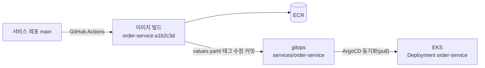

# gitops

> **"클러스터에 무엇이 떠 있어야 하는가"를 적어 둔 레포.** EKS 안의 ArgoCD가 이 레포를 지켜보다가, 바뀐 내용을 클러스터에 그대로 맞춘다. 사람은 클러스터에 직접 배포하지 않는다.

| 항목 | 내용 |
| --- | --- |
| 담당 | 김진아 |
| 관련 기능 ID | I-02 CI/CD |
| 기술 | Helm, ArgoCD (App of Apps), Kubernetes |
| 브랜치 | `main`만 + PR. `main`이 곧 클러스터의 목표 상태 |

---

## 1. 배포 흐름



- **CI(GitHub Actions)** 는 이미지를 ECR에 올리고, 이 레포의 `services/<서비스>/values.yaml` 이미지 태그를 바꾸는 커밋을 만든다. 커밋 메시지: `chore(order-service): image a1b2c3d`
- **CD(ArgoCD)** 는 클러스터 안에서 이 레포를 끌어가(pull) 적용한다. 그래서 CI는 클러스터에 접근할 필요가 없다.
- 사람이 바꾸는 값(파드 수, 환경 변수)은 PR로 바꾼다.

**왜 GitOps인가:** 지금 클러스터에 무엇이 떠 있는지 이 레포만 보면 안다. 롤백은 커밋 되돌리기다. 주말에 클러스터를 지웠다 다시 만들어도 ArgoCD만 다시 설치하면 이 레포 상태대로 앱이 자동으로 다시 올라온다.

**왜 `latest` 태그를 안 쓰나:** ArgoCD는 values의 태그가 바뀌어야 새 버전을 배포한다. 이미지 태그는 항상 git 커밋 7자리다.

## 2. 폴더 구조

```
gitops/
├── charts/
│   └── spring-service/          # 서비스 5개가 같이 쓰는 Helm 차트
├── services/
│   ├── gateway/values.yaml
│   ├── member-service/values.yaml
│   ├── inventory-service/values.yaml
│   ├── order-service/values.yaml
│   └── logistics-simulator/values.yaml
├── platform/
│   └── observability/           # Prometheus·Grafana·Loki·Alloy·Zipkin Application
└── argocd/
    ├── root-app.yaml            # App of Apps
    └── apps/                    # 서비스별 Application
```

관측성 스택(지표·로그·추적)은 [`platform/observability`](platform/observability/README.md)에서 `observability` 네임스페이스로 설치한다.

## 3. 공통 차트 `spring-service`가 챙기는 것

| 항목 | 기본값 | 이유 |
| --- | --- | --- |
| JVM 옵션 | `-XX:MaxRAMPercentage=75` | 컨테이너 메모리 상한을 넘어 OOMKilled 되는 것을 막는다 |
| readinessProbe | 초기 지연 넉넉히 | Spring Boot는 뜨는 데 20~40초 걸린다 |
| topologySpreadConstraints | 노드 간 분산 | 같은 서비스 파드 2개를 다른 AZ의 노드에 |
| ServiceAccount | 레포 이름 | IRSA Role `freshlink-<레포>-irsa`와 연결 |

## 4. 서비스별 파드 계획

| 서비스 | 파드 | CPU 요청 | 메모리 요청 / 상한 |
| --- | --- | --- | --- |
| gateway | 2 | 250m | 512Mi / 768Mi |
| member-service | 1 | 250m | 512Mi / 768Mi |
| inventory-service | 2 | 250m | 640Mi / 1Gi |
| order-service | 2 | 250m | 512Mi / 768Mi |
| logistics-simulator | 1 | 100m | 256Mi / 512Mi |

모든 리소스는 `freshlink` 네임스페이스에 올라간다. MVP에서는 HPA를 쓰지 않고 파드 수를 고정한다.

## 5. 사용법

> 아직 뼈대만 있는 상태다. 차트와 Application은 [infra](https://github.com/sesac-freshlink/infra)의 cluster 묶음이 완성된 뒤 채운다.

```bash
# 차트 검증
helm lint charts/spring-service
helm template order-service charts/spring-service -f services/order-service/values.yaml

# 클러스터를 새로 만든 뒤 한 번만 (이후는 ArgoCD가 알아서 동기화)
kubectl apply -n argocd -f argocd/root-app.yaml
```

## 6. 기여

- `main`만 쓴다. 사람이 바꾸는 값은 작업 브랜치 → PR → 승인 1명.
- 이미지 태그 변경은 CI가 자동 커밋한다. 손으로 고치지 않는다.
- 비밀값(DB 비밀번호, JWT 키, 토스 키)은 이 레포에 쓰지 않는다. Kubernetes Secret으로 따로 넣는다.
