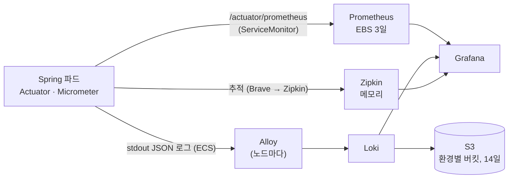

# platform/observability

> 관측성 스택(I-03, 할 일 16). **지표는 Prometheus, 로그는 Loki, 추적은 Zipkin, 화면은 Grafana 하나**로 본다. 전부 ArgoCD가 `observability` 네임스페이스에 설치한다.
> 결정 이유: [기획/기술스택과-선택이유.md](https://github.com/sesac-freshlink/.github/blob/main/docs/%EA%B8%B0%ED%9A%8D/%EA%B8%B0%EC%88%A0%EC%8A%A4%ED%83%9D%EA%B3%BC-%EC%84%A0%ED%83%9D%EC%9D%B4%EC%9C%A0.md) 3-5 · 구조도의 ⑬·청록색 파드: [docs/기획/architecture](https://github.com/sesac-freshlink/.github/tree/main/docs/기획/architecture)

## 1. 어떻게 올라가나

Application은 이 폴더가 아니라 App of Apps 차트 [`argocd/apps/templates/observability.yaml`](../../argocd/apps/templates/observability.yaml)이 만든다. 환경마다 켜고 끄는 값은 [`argocd/apps/values.yaml`](../../argocd/apps/values.yaml)의 `observability.enabled`다.

| 환경 | 상태 |
| --- | --- |
| dev | 켬 |
| prod | 끔. dev에서 확인한 뒤 `observability.enabled.prod: true` 한 줄로 켠다 |

| Application | 설치되는 것 | 값 파일 |
| --- | --- | --- |
| `observability-base` | 우선순위 클래스 `freshlink-observability`, Zipkin, Grafana 대시보드 ConfigMap | [`manifests/`](manifests/) (kustomize) |
| `kube-prometheus-stack` | Prometheus, Operator, kube-state-metrics, node-exporter, Grafana | [`values/kube-prometheus-stack.yaml`](values/kube-prometheus-stack.yaml) |
| `loki` | Loki (단일 바이너리) | [`values/loki.yaml`](values/loki.yaml) + 환경 값(버킷, IRSA) |
| `alloy` | Grafana Alloy (데몬셋) | [`values/alloy.yaml`](values/alloy.yaml) |

외부 차트 버전은 `argocd/apps/values.yaml`의 `observability.charts`에 고정한다(2026-10-20 기준 kube-prometheus-stack 92.10.1, loki 7.3.0, alloy 1.13.1, Zipkin 이미지 3.6.1).

환경마다 다른 값(Loki S3 버킷 이름, Loki IRSA Role ARN)은 공개 레포에 적지 않는다. infra `envs/<env>/cluster/helm.tf`의 root Application이 `cluster.observability.loki`로 넘긴다. 이 값이 없는 클러스터(infra apply 전)에서는 `loki` Application만 빠지고 나머지는 그대로 올라온다.

## 2. 흐름



### 서비스 쪽에 필요한 것

| 무엇 | 누가 | 어떻게 |
| --- | --- | --- |
| 지표 | 공용 차트 | `charts/spring-service`의 ServiceMonitor가 `/actuator/prometheus`를 30초마다 읽는다(Prometheus Operator CRD가 있는 클러스터에서만 만든다) |
| JSON 로그 | 공용 차트 | 환경 변수 `LOGGING_STRUCTURED_FORMAT_CONSOLE=ecs`. 서비스 코드는 고치지 않는다. PC 실행은 사람이 읽는 형식 그대로다 |
| p95 응답 시간 | 공용 차트 | `MANAGEMENT_METRICS_DISTRIBUTION_PERCENTILESHISTOGRAM_HTTP_SERVER_REQUESTS=true` |
| 추적 | 서비스 레포 + 공용 차트 | 서비스 `build.gradle`에 `spring-boot-starter-zipkin`, `application.yml`에 `management.tracing.export.zipkin.enabled: false`(PC 기본값). 클러스터에서는 차트가 `MANAGEMENT_TRACING_EXPORT_ZIPKIN_ENABLED=true`, 주소, 표본 비율 1.0을 넣는다 |
| SQS 너머 추적 | common v0.3.0 | Outbox 행의 `trace_parent`를 메시지 속성 `traceparent`로 실어 보내고 받는 쪽이 이어 받는다 |

## 3. 자원 (노드 2대 안에 들어가게)

모든 관측성 파드는 우선순위 클래스 `freshlink-observability`(값 -100)를 쓴다. 앱 파드(기본 0)보다 낮아서, 노드 자리가 모자라면 관측성 파드가 먼저 밀려나고 앱 파드가 뜬다.

| 구성 | 파드 | CPU 요청 | 메모리 요청 / 상한 |
| --- | --- | --- | --- |
| Prometheus (+ config-reloader) | 1 | 200m | 768Mi / 1.5Gi |
| Prometheus Operator | 1 | 50m | 128Mi / 256Mi |
| kube-state-metrics | 1 | 20m | 64Mi / 192Mi |
| node-exporter | 노드당 1 | 노드당 20m | 32Mi / 64Mi |
| Grafana (+ 사이드카 2) | 1 | 100m | 256Mi / 512Mi |
| Loki | 1 | 100m | 512Mi / 1Gi |
| Alloy | 노드당 1 | 노드당 50m | 128Mi / 256Mi |
| Zipkin | 1 | 100m | 512Mi / 768Mi |
| 합계 (노드 2대) | 10 | 약 0.71 vCPU | 약 2.6Gi |

## 4. 보관

| 무엇 | 어디 | 얼마나 | 클러스터를 지우면 |
| --- | --- | --- | --- |
| 지표 | Prometheus, EBS gp3 10Gi | 3일 (8GB 넘으면 오래된 것부터) | 사라진다. dev는 금요일 삭제 때 그 주 지표가 없어진다(2026-10-17 결정) |
| 로그 | Loki → S3 `freshlink-<env>-loki-logs-<계정 끝 4자리>` | 14일 (Loki 보관 + S3 수명 주기) | 남는다(버킷은 persistent 묶음) |
| 추적 | Zipkin 메모리 | 파드가 살아 있는 동안 | 사라진다 |

Loki WAL은 파드 안 임시 디스크에 둔다. Loki 파드가 재시작하면 아직 S3에 올라가지 않은 몇 분 치 로그를 잃을 수 있다.

## 5. 접속

Grafana·Prometheus·Zipkin은 밖으로 열지 않는다. 클러스터 관리자만 `kubectl port-forward`로 연다. Grafana는 로그인 화면 없이 바로 들어간다(port-forward를 할 수 있는 사람만 닿기 때문).

```powershell
# Grafana  → 브라우저 http://localhost:3000  (대시보드 > FreshLink > FreshLink 서비스)
kubectl -n observability port-forward svc/kube-prometheus-stack-grafana 3000:80
# Zipkin   → http://localhost:9411
kubectl -n observability port-forward svc/zipkin 9411:9411
# Prometheus 대상 확인 → http://localhost:9090/targets
kubectl -n observability port-forward svc/kube-prometheus-stack-prometheus 9090:9090
```

### 확인 순서 (할 일 16 완료 기준)

1. `kubectl -n argocd get applications` 에서 `observability-base`, `kube-prometheus-stack`, `loki`, `alloy`가 `Synced` / `Healthy`.
2. Prometheus `/targets`에서 `serviceMonitor/freshlink/<서비스>/0`이 UP.
3. Grafana `FreshLink 서비스` 대시보드에서 서비스별 요청 수·응답 시간·에러율·JVM이 보인다.
4. Grafana Explore → Loki에서 `{namespace="freshlink", app="gateway"}` 로그가 나온다. 로그 줄을 펼쳐 `traceId` 옆 Zipkin 링크를 누르면 그 요청의 추적이 열린다.
5. Zipkin에서 gateway → order-service 구간이 한 추적으로 보인다(서비스에 `spring-boot-starter-zipkin`이 들어간 뒤).

## 6. 대시보드 고치기

[`manifests/dashboards/`](manifests/dashboards/)의 JSON이 진실이다. Grafana 화면에서 고친 것은 Grafana 파드가 다시 뜨면 사라진다.

1. Grafana에서 대시보드를 고친다.
2. 대시보드 설정 → JSON Model을 복사해 `manifests/dashboards/<이름>.json`에 덮어쓴다.
3. 새 파일이면 `manifests/kustomization.yaml`의 `configMapGenerator`에 한 덩어리 더한다.
4. PR을 올리고 머지하면 ArgoCD가 ConfigMap을 바꾸고 Grafana 사이드카가 다시 읽는다.

쿠버네티스 기본 대시보드(노드·파드 자원 등)는 kube-prometheus-stack이 함께 넣는다.
