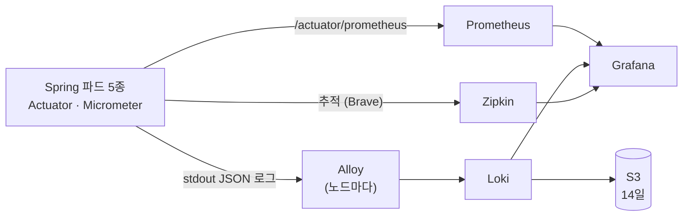

# platform/observability

> 관측성 스택(I-03). **지표는 Prometheus, 로그는 Loki, 추적은 Zipkin, 화면은 Grafana 하나**로 본다. 전부 ArgoCD가 `observability` 네임스페이스에 설치한다.
> 결정 이유: [infra/docs/기술스택과 선택이유.md](https://github.com/sesac-freshlink/infra/tree/main/docs) 3-5 · 구조도의 ⑬·청록색 파드: [docs/architecture](https://github.com/sesac-freshlink/.github/tree/main/docs/architecture)

| 파일 | 설치되는 것 | 핵심 설정 |
| --- | --- | --- |
| `kube-prometheus-stack.yaml` | Prometheus, Operator, kube-state-metrics, node-exporter, Grafana | Alertmanager 끔, 보관 3일, EBS gp3 10Gi, Grafana에 Loki·Zipkin 데이터 소스 |
| `loki.yaml` | Loki (단일 바이너리) | 저장소 S3(14일), 캐시·canary·gateway 끔 (안 끄면 메모리 수 GiB를 요청) |
| `alloy.yaml` | Grafana Alloy (데몬셋) | 노드의 파드 로그를 읽어 Loki로 보낸다. Promtail 대신 |
| `zipkin.yaml` + `zipkin/` | Zipkin | 메모리 저장, 파드 1개. 주소 `http://zipkin.observability:9411` |

## 흐름



## 자원 (노드 2대 안에 들어가게)

| 구성 | 파드 | CPU 요청 | 메모리 요청 |
| --- | --- | --- | --- |
| Prometheus + Operator + kube-state-metrics + node-exporter | 5 | 약 0.4 | 약 1.3Gi |
| Grafana | 1 | 100m | 256Mi |
| Loki | 1 | 100m | 512Mi |
| Alloy | 노드당 1 | 노드당 50m | 노드당 128Mi |
| Zipkin | 1 | 100m | 512Mi |

관측성 파드는 PriorityClass를 앱보다 낮게 둔다. 자리가 모자라면 Grafana·Zipkin이 먼저 밀려난다.

## 남은 일

- [ ] infra: Loki 로그 버킷(S3, 14일 수명 주기)과 Loki용 IRSA Role → `loki.yaml`의 버킷 이름·Role ARN 채우기
- [ ] infra: EBS CSI 드라이버와 `gp3` StorageClass (Prometheus 볼륨)
- [ ] 차트·이미지 버전을 설치 직전에 최신으로 고정 (`targetRevision`, zipkin 이미지 태그)
- [ ] `argocd/root-app.yaml`이 이 폴더도 읽게 하기
- [ ] `charts/spring-service`에 ServiceMonitor 넣기 (서비스 5개 자동 수집)
- [ ] Grafana 대시보드 JSON을 이 폴더에 두기 (클러스터를 다시 만들어도 그대로 복구)

## 접속

Grafana는 외부에 열지 않는다.

```bash
kubectl -n observability port-forward svc/kube-prometheus-stack-grafana 3000:80
```
